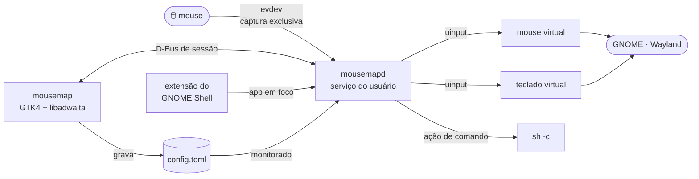

<div align="center">

# 🖱️ mousemap

**Botões extras do mouse do seu jeito — Linux, GNOME e Wayland**

Troca a inclinação da roda e os botões laterais por atalhos, comandos ou outros cliques,
configurado por uma janela simples. O Logi Options que a Logitech não fez para Linux.


[Destaques](#-destaques) ·
[Arquitetura](#%EF%B8%8F-arquitetura) ·
[Início rápido](#-início-rápido) ·
[Operação](#%EF%B8%8F-operação) ·
[Problemas comuns](#-solução-de-problemas) ·
[Especificação](SPEC.md)

</div>

---

> [!WARNING]
> O serviço **captura o mouse com exclusividade** e reemite os eventos por um dispositivo virtual. Para isso,
> o usuário da sessão recebe acesso a `/dev/uinput` e aos mouses (nunca aos teclados). **Solaar** e
> **logiops** rodando junto disputam os mesmos botões: feche-os.

## ✨ Destaques

- **4 botões extras:** roda inclinada para a esquerda e para a direita, lateral de trás e lateral da frente.
- **Perfis por aplicativo:** no Firefox a roda troca de aba, no resto troca de área de trabalho. Cada perfil só
  define o que muda; o resto segue o padrão. Uma extensão do GNOME Shell informa o app em foco.
- **Ações:** atalho de teclado, comando, outro clique (esquerdo, direito, meio, voltar, avançar), padrão ou
  desativado, mais 16 ações prontas (área de trabalho, volume, mídia, copiar e colar, captura de tela…).
- **Atalho gravado no teclado:** pressione as teclas no diálogo, inclusive com Super, sem disparar o atalho
  do sistema. Grava o código físico da tecla, então funciona igual em ABNT2 e US.
- **Identificar e Testar:** aperte o botão no mouse e a linha correspondente pisca; ▶ executa a ação na hora.
- **Vale na hora:** salvar grava o TOML e recarrega o serviço em menos de 1 s. Editar o arquivo à mão também
  recarrega sozinho; configuração inválida é recusada e a anterior continua valendo.
- **Nada fica preso:** o atalho fica pressionado enquanto o botão estiver; ao soltar, desconectar ou recarregar
  no meio do clique, tudo é liberado.
- **Falha segura:** se o serviço cair, o kernel devolve o mouse ao comportamento normal e o systemd o reinicia
  (watchdog de 10 s). Reconecta sozinho quando o Bluetooth volta.
- **Sem root no dia a dia:** a permissão vem de regra udev com `uaccess`; root só na instalação.
- **Diagnóstico guiado:** `mousemapd --diagnose` mostra o evento que cada botão realmente envia.

## 🏗️ Arquitetura



| Componente | O que faz |
|---|---|
| `mousemapd` | Captura o mouse, troca os 4 gatilhos, reemite o resto sem alteração; API D-Bus `io.github.mousemap.Daemon` |
| `mousemap` | Janela de configuração: escolhe o mouse, edita as ações, identifica e testa botões |
| `config.toml` | Fonte única da configuração (`~/.config/mousemap/`); a janela e a edição manual convivem |
| `mousemap-setup` | Regras udev e módulo `uinput`; a janela chama via `pkexec` quando falta permissão |
| Extensão do GNOME Shell | Informa ao serviço o aplicativo em foco (id e classe da janela, nunca o título) para os perfis |

## 🚀 Início rápido

> [!NOTE]
> Feito e testado no **Fedora 44 com GNOME/Wayland**. Precisa de `python3-evdev`, `python3-gobject`,
> `gtk4` e `libadwaita`, todos dos repositórios do Fedora.

**Pelo pacote RPM:**

```bash
bash tools/make-srpm.sh                                   # gera build/rpm/mousemap-<versão>.src.rpm
rpmbuild --rebuild build/rpm/mousemap-*.src.rpm --define "_topdir $PWD/build/rpmbuild"
sudo dnf install ./build/rpmbuild/RPMS/noarch/mousemap-*.noarch.rpm
```

**Direto do repositório (desenvolvimento):**

```bash
sudo bash tools/setup-system.sh   # uma vez: dependências + permissões (udev/uinput)
bash tools/install-dev.sh          # serviço do usuário, atalho no menu, comandos em ~/.local/bin
```

Depois abra **mousemap** no menu de aplicativos.

> [!TIP]
> Para os **perfis por aplicativo**, o GNOME precisa carregar a extensão: depois de instalar, **saia e entre na
> sessão** (no Wayland não há outro jeito) e ative-a pelo próprio mousemap, no grupo **Aplicativo**.

> [!IMPORTANT]
> Use um jeito ou o outro. A instalação de desenvolvimento em `~/.local` tem prioridade sobre o pacote:
> antes de instalar o RPM, rode `bash tools/install-dev.sh --uninstall`.

## ⚙️ Operação

### Comandos

| Comando | O que faz |
|---|---|
| `mousemap` | Abre a janela de configuração |
| `mousemapd --list` | Mouses detectados, barramento e botões extras de cada um |
| `mousemapd --check` | Valida o `config.toml` e mostra o mapeamento |
| `mousemapd --diagnose` | Pede uma ação por vez e compara o evento recebido com o esperado |
| `systemctl --user restart mousemapd` | Reinicia o serviço |
| `journalctl --user -u mousemapd -f` | Log do serviço |

### Configuração

`~/.config/mousemap/config.toml` — a janela grava este arquivo; editar à mão também vale.

```toml
version = 2

[settings]
device = "MX Anywhere 2S Mouse"   # vazio = primeiro mouse com botões extras
tilt_cooldown_ms = 350            # repetição com a roda mantida inclinada (100–2000)

[buttons]
tilt_left    = { preset = "workspace-prev" }
tilt_right   = { preset = "workspace-next" }
side_back    = { keys = "ctrl+c" }
side_forward = { cmd = "gnome-calculator" }

# Perfil: só o que muda no Firefox; side_back e side_forward seguem o padrão acima
[apps."org.mozilla.firefox"]
name = "Firefox"
tilt_left  = { keys = "ctrl+shift+TAB" }
tilt_right = { keys = "ctrl+TAB" }
```

O perfil é escolhido pelo id do aplicativo (o nome do `.desktop`, como `org.mozilla.firefox`) ou, se não
houver, pela classe da janela.

| Ação | Forma |
|---|---|
| Padrão | `"default"` |
| Desativado | `"none"` |
| Ação pronta | `{ preset = "volume-up" }` — lista em [`presets.py`](src/mousemap/presets.py) |
| Atalho | `{ keys = "super+PAGEUP" }` — até 5 teclas; modificadores `ctrl`, `alt`, `altgr`, `shift`, `super` |
| Comando | `{ cmd = "notify-send oi" }` — roda com `sh -c`, sem bloquear o serviço |
| Outro clique | `{ click = "middle" }` — `left`, `right`, `middle`, `back`, `forward` |

### Pacote e traduções

| Tarefa | Como |
|---|---|
| Build e testes sem pacote | `meson setup build && meson test -C build` |
| SRPM / RPM | `bash tools/make-srpm.sh` e `rpmbuild --rebuild` (seção acima) |
| Copr | Projeto apontando para este repositório, método **make_srpm** ([`.copr/Makefile`](.copr/Makefile)); o repositório precisa ser público |
| Mudou textos da interface | `xgettext --from-code=UTF-8 -L Python -k_ -f po/POTFILES -o po/mousemap.pot` e `msgmerge -U po/en.po po/mousemap.pot` |

As mensagens de origem estão em português; [`po/en.po`](po/en.po) traz o inglês.

## 📁 Estrutura

```text
src/mousemap/
├── config.py          # esquema v2 (e v1 do protótipo), validação, gravação atômica
├── keys.py            # nomes de tecla ⇄ códigos evdev ⇄ rótulos
├── presets.py         # ações prontas
├── i18n.py            # gettext
├── daemon/            # mousemapd: main, engine (remapeamento), device (sysfs), dbus_service, diagnose
└── gui/               # mousemap: window, action_dialog, app_picker, shell_extension, daemon_client
extension/             # extensão do GNOME Shell: extension.js (ligação) + focus.js (lógica testável)
data/                  # systemd, D-Bus, udev, polkit, .desktop, metainfo, ícone, mousemap-setup
packaging/             # mousemap.spec
po/                    # traduções
tools/                 # setup-system, install-dev, make-srpm
tests/                 # unittest + tests/extension (gjs)
```

## 🧪 Testes

```bash
PYTHONPATH=src python3 -m unittest discover -s tests -t .   # ou: meson test -C build
```

Cobrem o motor de remapeamento (ordem das teclas, intervalo de repetição, nada preso após recarga),
configuração v1/v2, perfis por aplicativo, nomes de tecla, detecção de mouses pelo sysfs, diagnóstico e a
consistência de versão e traduções. A extensão é testada com `gjs`, inclusive contra o `mousemapd` real num
barramento D-Bus isolado (pula se `gjs` não estiver instalado). O `meson test` também valida o `.desktop` e o metainfo; o `%check` do RPM roda tudo.

## 🩺 Solução de problemas

| Sintoma | O que fazer |
|---|---|
| 🔒 Faixa "Sem permissão para acessar o mouse" | Clique em **Configurar** (pede a senha) ou rode `sudo bash tools/setup-system.sh` |
| 🔀 Botão reconhecido como outro (ex.: roda à esquerda vira lateral) | Solaar ou logiops reprogramou o mouse. Feche-os e **desligue e ligue o mouse**. Confira com `mousemapd --diagnose` ([BUG-001](BUGS.md)) |
| 🖱️ Botão não aparece em "Identificar botão" | Mesma causa acima, ou o mouse envia outro código: `mousemapd --diagnose` mostra qual |
| ⏸️ Faixa "O serviço não está rodando" | Clique em **Iniciar** ou `systemctl --user start mousemapd`; o motivo fica em `journalctl --user -u mousemapd` |
| 📴 Faixa "Mouse desconectado" | Ligue o mouse; o serviço recaptura em até 2 s. Ou escolha outro em **Dispositivo** |
| ⌨️ GNOME pede permissão ao gravar atalho com Super | Esperado: o app pede para segurar os atalhos do sistema durante a gravação. Aceite, ou digite o atalho no campo |
| 🧩 Extensão "Não carregada" | O GNOME só detecta extensão nova ao entrar na sessão: saia e entre, depois clique em **Ativar** |
| 🪟 Perfil não é aplicado num app | Veja em **Aplicativo → Extensão do GNOME** o id em foco e crie o perfil com esse id (ou com a classe da janela) |
| ⚠️ Faixa "Erro na configuração" | O arquivo editado à mão é inválido; a mensagem diz o que está errado (e a linha, se for erro de sintaxe). A configuração anterior segue valendo |

Bugs conhecidos e investigados ficam em [BUGS.md](BUGS.md).

## 🗺️ Roadmap

- [x] **M0** Protótipo em linha de comando
- [x] **M1** Serviço com D-Bus, reconexão, recarga e watchdog
- [x] **M2** Janela de configuração: captura de atalho, identificar e testar
- [x] **M3** Empacotamento: meson, RPM, traduções pt-BR/en, ícone
- [ ] Publicar no Copr
- [x] **M4** Perfis por aplicativo (extensão do GNOME Shell)
- [ ] **M5** Macros, mais botões e vários mouses

Detalhes em [`SPEC.md`](SPEC.md#12-roadmap).

<div align="center">
<sub>Uso pessoal · licença MIT · não é afiliado à Logitech</sub>
</div>
